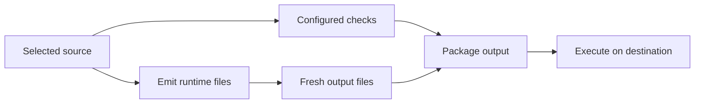

## 5.1. Read a toolchain diagram and classify a failure

A colleague reports “the toolchain passed locally, but the application fails on
the destination.” Before choosing a repair, determine which tools ran, which
files they used, and which result was actually delivered. “Toolchain” is a useful
collective term, but it is not one indivisible operation.

Read this domain's earlier lessons first. The diagram and evidence cards below
are constructed exercises, not a project that was built or deployed for this page.

### 1) **Trace inputs outputs and gates through a toolchain**

A **toolchain** is a set of tools used together to develop, check, transform or
execute software. A **pipeline** organizes steps and their dependencies. Some
steps produce files for later steps; others produce a decision or diagnostic
report. A **gate** is a condition that must be satisfied before proceeding under
the project's policy.

This fictional pipeline reads one selected source revision. The check step must
pass before packaging; the emitter separately produces the files to package.
“Emit” means produce output. Follow the arrows as dependencies, not as evidence
that a step succeeded:

The diagram says what should depend on what. It does not identify tool versions,
prove the checks' scope, or show a particular run's results. If the gate is not
actually enforced, the real process may differ from the drawing.

Ask two questions at every arrow: “Which exact output crosses this boundary?”
and “What evidence says it belongs to this run?” A directory named `output` may
contain yesterday's files. An archive's existence alone does not tie it to today's
source or establish that the destination executed it.

### 2) **Classify the failure at the step that produced evidence**

Read this constructed card for a tiny two-file Python report:

| Evidence | Reported observation |
|---|---|
| Intended source | `report.py` imports `lesson_math.py` from the same project |
| Local execution | The two files together print the expected report |
| Delivery inspection | The archive contains `report.py` but omits `lesson_math.py` |
| Destination | Fresh CPython process; omitted helper is unavailable elsewhere |
| Destination result | Missing-module failure when the import is reached |

The observed failure belongs to module loading during execution. The delivery
inspection gives a concrete reason to investigate packaging: the required local
module was omitted. Successful local execution tested a different arrangement,
with the helper present. The [local dependency lesson](<../3. Tools and interfaces/3.2. Packages modules dependencies and package managers.md>)
contains the real two-file experiment behind this kind of distinction; this card
remains fictional.

A poor repair is “Install a package whose name resembles the missing import.”
It changes the environment without establishing that it supplies the intended
project helper. A targeted repair is to include the actual required helper in
the delivery output, then run the packaged arrangement in a fresh representative
environment. That is the next verification to perform, not a check already passed
by reading this card.

Compare two other constructed symptoms:

| Symptom | First boundary to investigate |
|---|---|
| An emitter rejects source syntax before producing output | Its parser, supported syntax and configuration |
| A source file saves successfully in the editor | Editing succeeded; execution and tool checks remain separate questions |

Neither symptom proves a language bug. Identify the operation and its contract
before replacing the runtime or changing unrelated code.

### 3) **Write a handoff that preserves versions and unfinished checks**

Now consider a different constructed run. The latest emitter reports failure,
but an old output directory still exists. A later packaging script archives that
directory and reports success. “The build produced the new release” is unsupported.
Packaging success and output freshness are separate claims. First determine
whether execution should have stopped after the failed emission and which files
were actually archived.

A useful handoff records the source identity, tool versions and configuration,
exact command or selected action, relevant input/output paths, reported failure
and remaining verification. For the missing-helper case, an example is:

> Local execution used both project files. Archive inspection found only the
> report, and the destination run could not load the omitted helper. Include the
> project helper in the package, then rerun the packaged report in a fresh target
> environment. Record that environment's implementation version and result.

This states an evidence-supported direction without inventing an unobserved
successful repair. If the card did not supply destination-version evidence, do
not fill the gap with the local version. Ask for the missing fact.

Interview practice: “The editor shows no errors. Why did the command fail?” A
sound answer asks whether the editor and command analyzed the same saved files,
configuration, tool version and project scope. It then inspects the actual command
result. Naming a possible mismatch is a hypothesis; comparing those inputs is how
to establish whether the hypothesis applies.

### 4) **Common confusion**

A pipeline diagram describes intended relationships, while a run record describes
observed events. A green packaging step does not retroactively turn an earlier
failed emitter into a pass. Likewise, a local source run does not automatically
exercise a packaged output or a destination environment.

Do not classify failures only by the word “build” in a button label. Read which
component reported the problem and what it was doing at that boundary.

### 5) **Performance note**

Toolchain stages have separate time and resource costs. A slow editor query,
package download and application startup are different measurements. This exercise
measures none of them. Repeating the entire pipeline may obscure the stage of
interest; collect stage evidence while preserving the inputs and required gates.
Do not bypass a failed correctness check merely to obtain a shorter total time.

### 6) **Mentor note**

Ask a learner to mark every card row as intent, inspection, execution result or
unknown. Then remove the archive-inspection row and ask how confident the diagnosis
can remain. A strong answer changes from a supported omission diagnosis to a
hypothesis requiring delivery inspection, without losing the known loading failure.

### 7) **Cross-links**

- [Checks and builds](<../4. Checking and transforming code/4.1. Static analysis types linting formatting and builds.md>) — identify the limits of each gate.
- [Artifact consumers](<../1. Software categories/1.2. Source code executables bytecode and artifacts.md>) — distinguish produced files from executed behavior.
- [Testable status messages](<../../../01 Reading and Using Technical Language/sections/4. Applied reading and review/4.1. Turn a jargon-heavy message into a testable statement.md>) — preserve evidence and unperformed verification.
